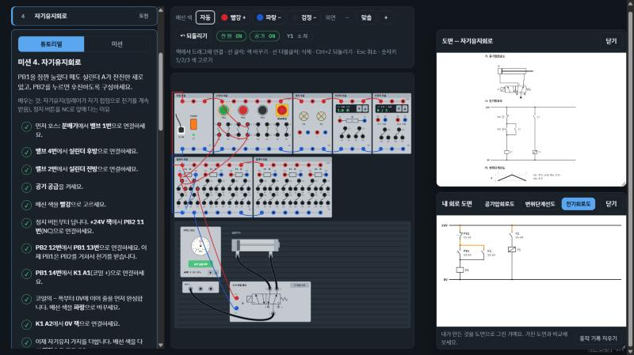
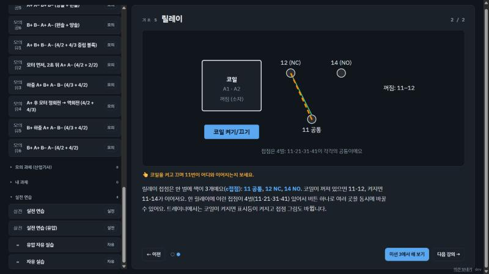
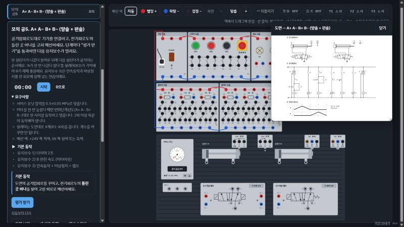

# 설비보전 공유압 트레이너

**바로 써 보기: https://hp-trainer.heathive.workers.dev/** (PC 브라우저 권장)

설비보전기사 실기 작업형(공기압·유압) 과제를 **실습 장비 없이** 연습하는 PC용 웹 시뮬레이터입니다.
바나나잭 배선과 공압·유압 호스를 직접 꽂고, 누름버튼을 눌러 릴레이·솔레노이드·실린더가 실제처럼 움직이는 것을 볼 수 있어요.

| 기초 강의 (눌러 보는 그림) | 모의 과제 (도면 보고 혼자 꾸미기) |
| --- | --- |
|  |  |

## 들어 있는 것

- **기초 강의 12개**: 전기가 흐르는 길, 트레이너 둘러보기, 스위치(NO/NC), 직렬·병렬, 릴레이, 솔레노이드 밸브와 실린더, 전기회로도 읽기, 센서·리밋스위치, 유압 3개(유압은 무엇이 다를까, 4/3 밸브와 유압모터, 체크밸브와 속도 조절), 그리고 **변위단계선도 보고 전기회로 설계하기**(산업기사 대비). 그림 속 버튼을 눌러 보며 익혀요.
- **미션 0~14 + 튜토리얼**: 램프 켜기부터 자기유지, 리밋·센서 자동 후진, 2실린더 시퀀스, 연속동작, 카운터, 타이머, 비상정지, 유량조절·급속배기·감압, 틀린 회로도 고치기까지. 튜토리얼은 다음에 꽂을 잭을 하나씩 알려 주고, 미션은 동작 결과로 채점해요.
- **유압 미션 H1~H18**: 파워유닛·릴리프, 4/2·4/3·2/2 밸브, 유압모터, 체크밸브, 미터인·블리드오프, 감압, 압력스위치, 카운터밸런스, 로킹 회로, 실린더·모터 시퀀스, 유압 오류 찾기.
- **설계 연습 D1~D6 (산업기사형)**: 전기회로도 없이 변위단계선도만 보고 직접 설계해요. 힌트를 하나씩 열어 볼 수 있고, 채점은 동작 결과로만 해서 다른 설계도 통과해요.
- **모의 과제**: 시험 규모로 직접 설계한 세트. 기사형 12세트(틀린 곳 하나가 있는 전기회로도 + 유지보수 3문항)와 산업기사형 8세트(전기회로도 없이 설계 + 유지보수 2~3문항). 단계마다 "평가 받기", 스톱워치, 단계별 걸린 시간과 최고 기록.
- **시험 모드**: 공압 과제 하나와 유압 과제 하나를 무작위로 골라 시간 제한 안에 이어서 풀어요. 시험 중에는 내 회로 도면·채점 힌트·해설이 보이지 않고, 끝나면 결과표가 나와요.
- **내 과제**: 가진 도면을 보고 판 구성·변위단계선도·규칙(2회 반복, 릴레이 개수, 압력, 타이머, 속도 조절, 설정값)을 정해 나만의 채점 과제를 만들어요. 도면 사진 첨부, 파일로 내보내기·불러오기. 이 브라우저에만 저장돼요.
- **시연 보기**: 튜토리얼마다 앱이 빈 판에서 선을 하나씩 꽂으며 직접 해 보여 줘요 (일시정지·한 단계·빠르기).
- **실전 연습**: 가지고 있는 공개도면을 보며 판 구성(밸브 종류, 센서 위치, 유지보수 기기)을 직접 고르고 (공압·유압), 스톱워치로 시간을 재며 꾸며요.
- **내 회로 도면**: 내가 꽂은 호스를 공기압·유압회로도로, 배선을 전기회로도(사다리)로, 실제 움직임을 변위단계선도로 그려 줘서 받은 도면과 비교할 수 있어요.

진행 상황과 배선은 브라우저에 자동 저장됩니다(서버·로그인 없음).
설정 ⚙의 **내 기록 내보내기 / 불러오기**로 파일에 보관하거나 다른 컴퓨터로 옮길 수 있어요.

## 쓰는 법

- 웹: 배포된 주소에서 바로 쓰면 됩니다. PC 브라우저(크롬·엣지 등)를 권장해요.
- 내 PC: 저장소를 받은 뒤 `index.html`을 브라우저로 열면 됩니다.
- 처음이라면 목록 맨 위 **기초 강의 1**부터 보고, 강의 끝의 "미션에서 해 보기"로 넘어가세요.

### 조작

| 하고 싶은 것 | 방법 |
| --- | --- |
| 선·호스 꽂기 | 잭에서 잭으로 끌기 (또는 잭을 하나씩 차례로 클릭) |
| 선·호스 빼기 | 선을 더블클릭 (호스는 공기·펌프를 끈 뒤에만) |
| 선 색 바꾸기 | 선을 한 번 클릭 (빨강 → 파랑 → 검정), 숫자키 1·2·3으로 미리 고르기 |
| 방금 한 것 되돌리기 | Ctrl+Z 또는 툴바의 ↶ 되돌리기 |
| 어느 선인지 헷갈릴 때 | 선이나 잭에 마우스를 올리면 그 선만 진하게 보여요 |
| 화면 키우기 | 툴바의 − / 맞춤 / + |

불편한 점이나 바라는 점은 화면 오른쪽 아래 **의견 보내기**(GitHub 이슈)로 알려 주세요.

## 개발

- 순수 JavaScript + SVG, 빌드 도구·외부 패키지 없음
- 테스트: `npm test` (Node.js 내장 테스트). GitHub에 올리면 자동으로도 돌아요 (`.github/workflows/test.yml`)
- 배포용 파일 모으기: `npm run build` → `dist/`
- 미션 도면 다시 만들기: `node tools/make-diagrams.js`

## 저작권 안내

설비보전기사 공개과제 도면은 한국산업인력공단의 저작물이며, 이 저장소에는 **포함하지 않습니다**.
미션의 회로와 도면은 이 프로젝트에서 직접 만든 것입니다. 실전 연습은 각자 가진 공개도면을 보고 진행하세요.

## 라이선스

[MIT](LICENSE) — 누구나 자유롭게 쓰고, 고치고, 다시 배포할 수 있어요. 저작권 표시만 남겨 주세요.
